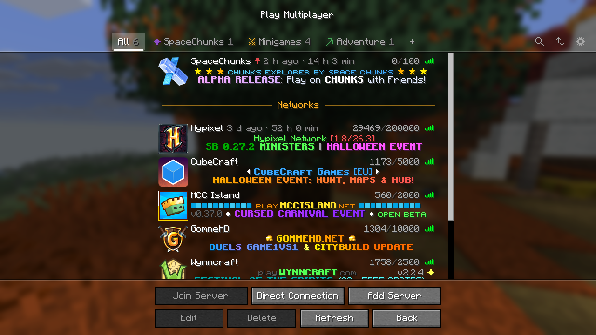
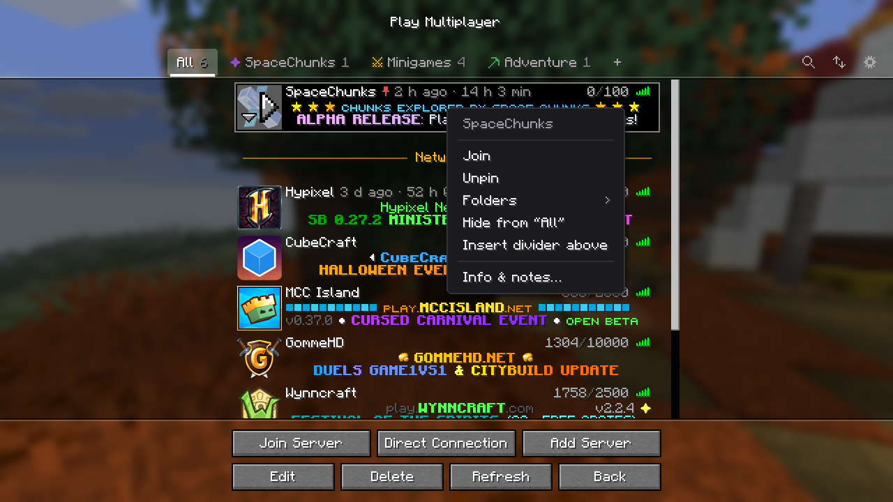
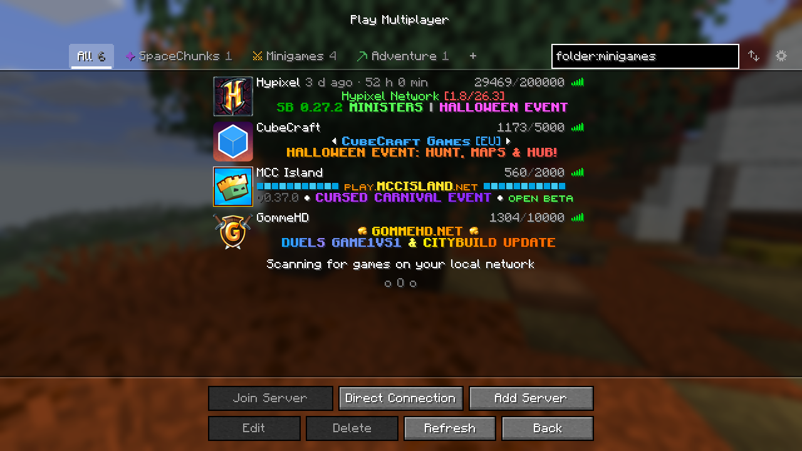
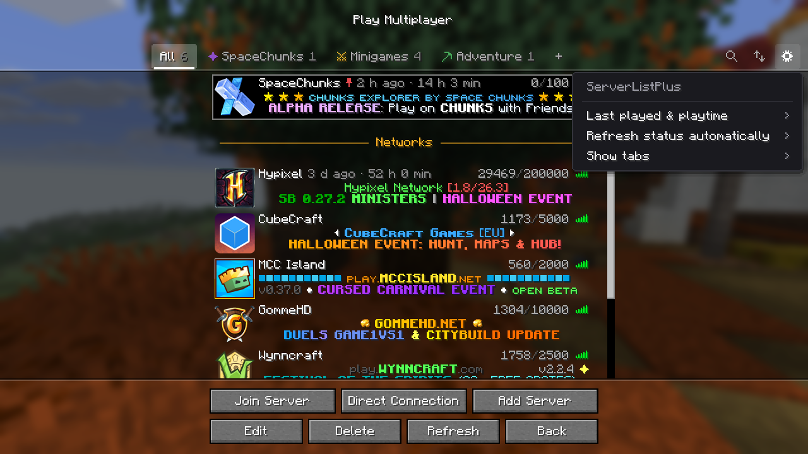
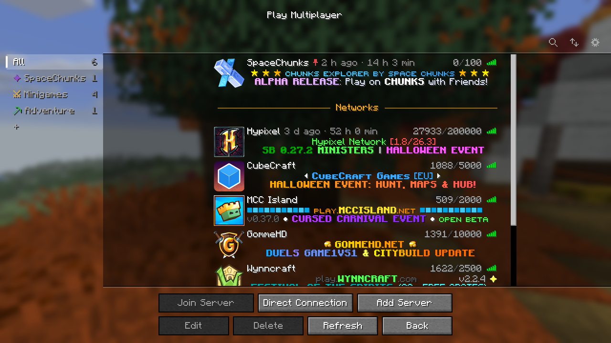
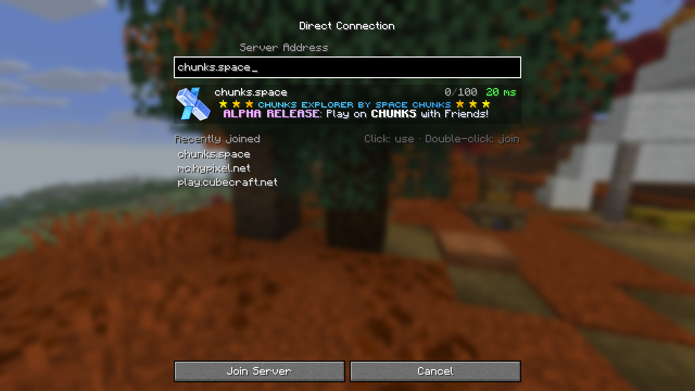

# ServerListPlus

![Banner][banner]

A client-side Minecraft mod that makes the multiplayer server list actually manageable:
folders as tabs, search with filters, sorting, pinning, notes, tags and playtime, all
without touching `servers.dat`. Remove the mod and your server list is exactly as before.

## Features

- **Tabs for folders**: "All" plus one tab per folder, as a row above the list or as a sidebar.
  A server can be in any number of folders; drag it onto a tab to put it there.
- **Smart folders**: save a search as a folder that fills itself, e.g. `tag:pvp ping:<80`.
- **Search and filters**: by name, address and MOTD, plus `tag:`, `folder:`, `ping:`, `players:`,
  `domain:`, `is:pinned` and `is:hidden`. See [Search](#search).
- **Sorting**: manually by drag and drop, or by name, ping, players or last played.
- **Pinning**: keep servers at the top of a tab, also while sorting automatically.
- **Dividers**: titled, colored separators to group servers within a tab.
- **Hiding**: keep servers out of "All" without deleting them; they wait in a folded section.
- **Notes, tags and history**: per server notes and tags; last join and total playtime per address,
  shown next to the name, as a clock symbol, on hover or not at all.
- **Colored names**: MiniMessage tags in server names, e.g. `<gradient:#ff5555:#ffaa00>Hypixel</gradient> <gray>Lobby`.
- **Direct Connection**: a live preview of the typed server and the addresses you joined last.
- **Auto refresh**: re-ping the shown servers every few seconds, without the list flickering.
- **Looks**: tab colors and symbols, background gradients or your own pictures per tab.

| Right-click menu | Search | Settings |
|---|---|---|
|  |  |  |

| Tabs as a sidebar | Direct Connection |
|---|---|
|  |  |

## Installation

1. Install [Fabric](https://fabricmc.net/use/) with the [Fabric API](https://modrinth.com/mod/fabric-api),
   or [NeoForge](https://neoforged.net/).
2. Download the jar for your Minecraft version and loader from the
   [releases](https://github.com/PrexorJustin/ServerListPlus/releases).
3. Put it into the `mods` folder of your instance.

| Minecraft | Fabric | NeoForge |
|---|---|---|
| 1.20.5 – 1.20.6 | ✓ | ✓ |
| 1.21 – 1.21.11 | ✓ | ✓ |
| 26.1 – 26.3 | ✓ | ✓ |

## Usage

| To | Do |
|---|---|
| Create a folder | Click **+** next to the tabs |
| Rename a tab or divider | Double click it |
| Change a tab's color, symbol or background | Right click the tab |
| Put a server into folders | Right click it → **Folders**, or drag it onto a tab |
| Pin, hide or annotate a server | Right click it |
| Add a divider | Right click a server → **Insert divider above** |
| Search | Click the magnifier or press **Ctrl+F** |
| Change sorting | Click the arrows next to the search |
| Move the selected server | Drag it, or **Shift+↑/↓** (also across dividers) |
| Settings | Click the gear: details display, auto refresh, tab layout |

A server named `Friends/Survival SMP` is put into the folder "Friends" (created if needed)
and named "Survival SMP".

Server names understand MiniMessage colors (`<red>`, `<#ff8800>`, `<color:gold>`), decorations
(`<bold>`, `<italic>`, `<underlined>`, `<strikethrough>`, `<obfuscated>`, negated as `<!bold>`),
`<gradient:…>`, `<rainbow>` and `<reset>`. Unknown tags stay as typed, `\<` writes a plain `<`.
Search and sorting use the name without tags.

### Search

All terms must match. Case and Minecraft color codes are ignored.

| Term | Matches |
|---|---|
| `survival` | name, address or MOTD contains the word |
| `"mini games"` | the exact phrase |
| `tag:pvp` | a tag starting with "pvp" (`tag:"mini g"` works too) |
| `folder:friends` | one of its folders contains "friends" |
| `is:pinned` | pinned in any tab |
| `is:hidden` | hidden from "All"; searching for it shows them there |
| `ping:<100`, `players:>10` | compares ping or online players with `<`, `>` or `=` |
| `domain:example.com` | that domain and its subdomains (`host:` works too) |
| `domain:*.example.com` | `*` matches anything, here only subdomains |
| `-term` | negates any term, e.g. `-tag:modded` |

Servers that were not pinged yet or are offline never match `ping:` or `players:`.

## Your data

Everything ServerListPlus adds is stored in `config/serverlistplus/servers.json`; your own
pictures for backgrounds go into `config/serverlistplus/wallpapers/`. The vanilla
`servers.dat` only changes the way it would without the mod: when you reorder or add servers,
and when a server sends a new icon.

Servers are recognised by address and name. Two entries with the same address are separate
servers (e.g. a network listed twice under different names), while playtime and last join
are shared by address. Data of a deleted server is kept for 30 days in case it comes back.

## Contributing

Bug reports, ideas and pull requests are welcome. [CONTRIBUTING.md](CONTRIBUTING.md) explains
how to build, test and change the mod; [docs/ARCHITECTURE.md](docs/ARCHITECTURE.md) explains
how it is put together.

## License

[MIT](LICENSE)

[banner]: docs/images/brand/readme-banner.png
